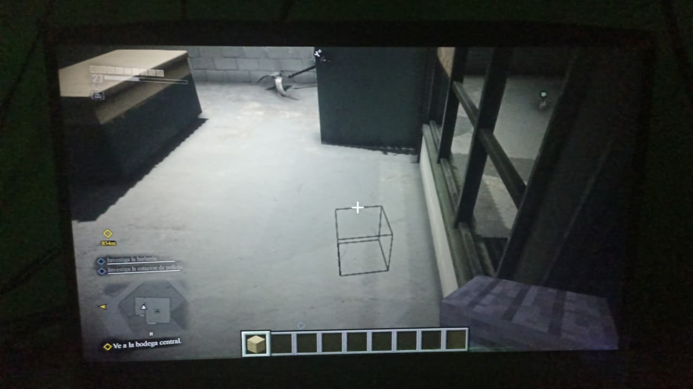
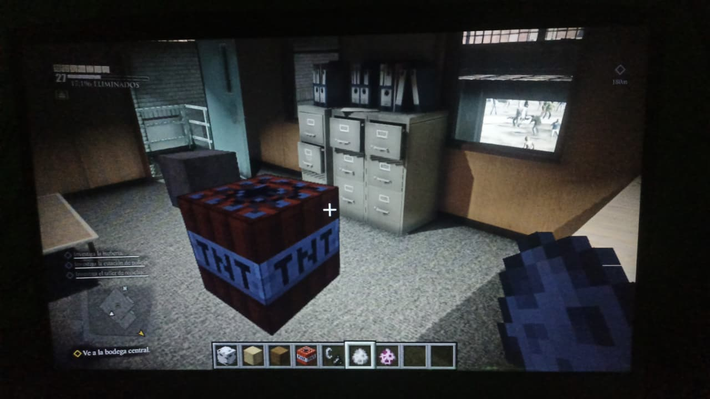
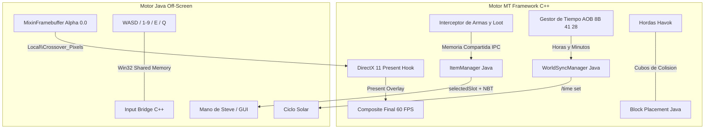

# Dead Rising 3 x Minecraft: Symbiosis Crossover

[]()
[]()
[]()
[]()




Proyecto de ingeniería inversa de bajo nivel, inyección nativa en memoria (x64) y comunicación inter-proceso (IPC) en tiempo real que integra de manera simbiótica el motor **MT Framework** de **Dead Rising 3** (Capcom) con el cliente Java de **Minecraft** (**Fabric Loader 1.20.1**).

Minecraft deja de ser un juego independiente para transformarse en una **capa interactiva (Overlay transparente a 60 FPS)** superpuesta en el SwapChain de DirectX 11 de Dead Rising 3, sincronizando inventario dinámico, barra de vida y hambre, combate cuerpo a cuerpo y a distancia, durabilidad en tiempo real, ciclo solar, movimiento en primera/tercera persona y colisiones físicas Havok.

---

## 1. Novedades y Estado Actual 

###  Renderizado Visual 
- **Eliminación Total de la Viñeta Vanilla:** Minecraft ya no oscurece la pantalla ni limita la visibilidad a las casillas de la hotbar. Gracias a [`MixinInGameHud`](modMinecraft/src/main/java/com/crossover/mixins/MixinInGameHud.java) y [`MixinFramebuffer`](modMinecraft/src/main/java/com/crossover/mixins/MixinFramebuffer.java), se anularon los shaders de viñeta (`renderVignetteOverlay`), catalejos y portales, garantizando un **Canal Alfa = 0.0 puro** en todo el espacio vacío. El mundo 3D de Dead Rising 3 se aprecia nítido y fluido.
- **Ventana de Inventario Flotante:** [`MixinScreen`](modMinecraft/src/main/java/com/crossover/mixins/MixinScreen.java) suprime el oscurecimiento de fondo (`renderBackground`), de modo que al abrir el inventario (**tecla 'E'**), la interfaz gráfica de Minecraft flota limpiamente sobre Los Perdidos.

### ⚔️ Manipulación Universal de Armas y Combate
- **Ataque y Balanceo Activo:** El clic izquierdo del ratón ahora dispara órdenes de ataque universales en 1ra y 3ra persona. Funciona para todas las armas: espadas y herramientas de Minecraft, armas importadas de Dead Rising 3 y combate con los puños, ejecutando el balanceo del brazo (`swingHand`) y causando daño a entidades o zombies.
- **Lanzamiento de Proyectiles Havok ('Q'):** Arrojar cualquier ítem de Minecraft o Dead Rising 3 con la tecla 'Q' lo transforma en un objeto balístico con físicas Havok en Los Perdidos, dañando a los no-muertos.

###  Colocación y Minado de Bloques en Tiempo Real
- **Construcción en 3D:** Al sostener cualquier bloque de Minecraft en la mano, hacer clic derecho coloca el bloque en el mundo 3D frente al jugador. [`MixinWorldRenderer`](modMinecraft/src/main/java/com/crossover/mixins/MixinWorldRenderer.java) permite el renderizado de vóxeles colocados por el jugador sobre el escenario de Dead Rising 3.
- **Minado y Destrucción:** El clic izquierdo sobre bloques colocados permite minarlos y romperlos interactivamente.

###  Arsenal de Dead Rising 3 en el Menú Creativo de Minecraft
- **Acceso Directo desde la Pestaña de Combate:** [`ModItems`](modMinecraft/src/main/java/com/crossover/player/item/ModItems.java) expone directamente en el menú creativo de Minecraft las armas icónicas de Dead Rising 3:
  - *Motosierra de Los Perdidos*
  - *Maza Sledgehammer*
  - *Sable de Luz Láser*
  - *Defiler Sledge-Axe*
  - *Freedom Bear Sentry*
  - *Espada Dragón Llameante*
  - *Super B.F.G. 9000*
  - *Bate con Clavos*
- Al tomarlas del inventario, se equipan automáticamente en la hotbar con sus iconos VRAM originales, etiquetas NBT y barras de durabilidad activas.

###  Retargeting Esquelético y Animación Fluida en 3ra Persona
- **Sincronización Métrica de Coordenadas:** Se corrigió el posicionamiento espacial de Steve, anclándolo de forma exacta a las coordenadas de Nick Ramos en MT Framework.
- **Cinemática Dinámica:** Cuando Dead Rising 3 transmite datos de huesos, los cuaterniones se aplican a la cabeza, torso, brazos y piernas de Steve; en caso de ausencia de mocap o movimiento procedural, Steve conserva sus animaciones naturales de caminata y carrera de Minecraft sin congelarse como maniquí estático.

---

## 2. Los 5 Pilares del Crossover



### Pilar 1: Renderizado Visual y GUI (La Máscara de Cristal)
- Minecraft opera en modo **Headless/Off-Screen** renderizando únicamente los elementos de Steve, manos en 1ra persona, partículas, ítems y HUD sobre un Framebuffer RGBA con **Alfa 0.0**.
- La textura resultante se copia mediante memoria compartida (`Local\Crossover_Pixels`) y se dibuja sobre el BackBuffer de DirectX 11 en Dead Rising 3 antes del volcado a pantalla.

### Pilar 2: Modo Títere y Cinemática de Huesos (Puppet Master)
- **Modo 3ra Persona:** Dead Rising 3 comanda la física de Nick Ramos. El módulo de retargeting esquelético lee la cinemática directa de MT Framework (cabeza, torso, brazos y piernas) e inyecta los cuaterniones rotacionales en las 6 cajas anatómicas del modelo de Steve.
- **Modo 1ra Persona:** Nick Ramos se oculta y Steve asume el control del movimiento con físicas y apuntado coordinado.

### Pilar 3: Ecosistema del Inventario Dinámico (El Camaleón)
- Sin tablas fijas ni mapeos estáticos: cualquier arma creada, combinada o recogida en Los Perdidos se transmite como paquete NBT a [`ItemDeadRising`](modMinecraft/src/main/java/com/crossover/player/item/ItemDeadRising.java), adoptando nombre original, durabilidad, munición e icono extraído de VRAM.

### Pilar 4: Lanzamiento Havok y Acciones Físicas
- Al presionar **'Q'** teniendo un ítem de Minecraft (espadas, hachas, picos, comida o bloques), el objeto se lanza al mundo de Dead Rising 3 con vector de fuerza e impulso balístico Havok, impactando físicamente contra los zombies con detección de daño y efectos de impacto crítico.
- Clic izquierdo dispara ataques cuerpo a cuerpo y clic derecho permite consumir alimentos o usar bloques nativos.

### Pilar 5: Sincronización del Entorno y Construcción
- **Reloj Solar:** La firma AOB `8B 41 28` lee el tiempo transcurrido del mundo de Capcom y ajusta la hora de Minecraft a 20 TPS.
- **Muros Havok:** Cuando el jugador coloca bloques en Minecraft, se generan barreras de colisión estáticas de 1x1x1m en el motor de físicas de Dead Rising 3, frenando el paso de las hordas de zombies.

---

## 3. Controles y Atajos en el Juego

| Tecla / Control | Acción | Descripción |
| :--- | :--- | :--- |
| **`.` (Punto)** | **Interruptor de Realidades** | Activa o desactiva de inmediato el modo Crossover. |
| **`,` (Coma)** | **Alternar Perspectiva** | Cambia entre Primera Persona y Tercera Persona (detrás). |
| **`Ñ`** | **Cámara Selfie** | Alterna Tercera Persona Frontal. |
| **`{` / `[`** | **Ciclo de Cámaras** | Rota consecutivamente entre las 3 perspectivas de cámara. |
| **`1` a `9`** | **Seleccionar Slot** | Selecciona directamente los slots 1 al 9 de la hotbar de Minecraft. |
| **Rueda del Ratón** | **Desplazamiento Hotbar** | Navega entre los objetos de la barra rápida de Minecraft. |
| **`E`** | **Inventario Minecraft** | Abre o cierra el inventario 'E' con control de ratón nativo y fondo transparente. |
| **`Escape`** | **Cerrar Interfaz** | Cierra cualquier menú o inventario abierto sin activar la pausa de DR3. |
| **`Q`** | **Lanzar Proyectil Havok** | Arroja el ítem sostenido con giro físico y daño a zombies. |
| **Clic Izquierdo** | **Ataque / Golpear** | Ataca con el arma activa (de Dead Rising 3 o de Minecraft). |
| **Clic Derecho** | **Uso Nativo / Bloques** | Consume comida de Minecraft, coloca bloques o apunta armas de DR3. |
| **`WASD`** | **Movimiento** | Control de desplazamiento del personaje. |
| **`Espacio`** | **Salto** | Hace saltar al personaje. |
| **`Shift`** | **Agacharse** | Modo sigilo / agachado. |

---

## 4. Stack Tecnológico y Requisitos

### Módulo Nativo C++ (Dead Rising 3 Hook)
- **Lenguaje:** C++20
- **Compilador:** Microsoft Visual C++ (MSVC v143 - Visual Studio 2022 Build Tools)
- **Arquitectura:** x64
- **APIs:** DirectX 11 (`d3d11.lib`, `dxgi.lib`), MinHook v1.3.3, Dear ImGui
- **Inyección:** Proxy `dinput8.dll` con exportación limpia `DirectInput8Create`

### Módulo Java (Mod Fabric Minecraft)
- **Minecraft:** Java Edition 1.20.1
- **Mod Loader:** Fabric Loader >= 0.15.11
- **Mapeos:** Yarn Mappings 1.20.1+build.10 (v2)
- **API:** Fabric API 0.92.2+1.20.1
- **Mixins:** SpongePowered Mixin 0.8.5
- **JDK:** OpenJDK 17 (Java 17 x64)
- **Build System:** Gradle 8.9 con Fabric Loom 1.7.4

### Memoria Compartida Win32 (IPC)
- `Local\Crossover_Data` (10 MB): Telemetría bidireccional, rotación de huesos, salud, durabilidad, inventario y comandos de entrada.
- `Local\Crossover_Pixels`: Buffer de intercambio de fotogramas RGBA con canal alfa a 60 FPS.
- **Acceso Java:** `sun.misc.Unsafe` y JNA 5.13.0 para latencia de acceso en microsegundos.

### Lanzador y Orquestador
- Python 3.10+ con `psutil`, `pywin32` y `minecraft-launcher-lib`.

---

## 5. Instrucciones de Compilación y Despliegue

### Compilación
Ejecuta en la raíz del repositorio:
```cmd
compilar_todos_los_mods.bat
```
El script compilará automáticamente la DLL nativa (`dinput8.dll`), el mod de Minecraft (`crossover-mod.jar`), y desplegará los binarios en las carpetas de Steam y `%APPDATA%\.crossover_mc\mods\`.

### Compilación Manual por Componentes

#### 1. DLL de Dead Rising 3 (C++)
```cmd
"C:\Program Files (x86)\Microsoft Visual Studio\2022\BuildTools\MSBuild\Current\Bin\MSBuild.exe" DR3Hook\DR3Hook.sln /p:Configuration=Release /p:Platform=x64
```
El binario resultante se generará en `DR3Hook\x64\Release\DR3Hook.asi` (renombrable a `dinput8.dll`).

#### 2. Mod Fabric de Minecraft (Java)
```cmd
cd modMinecraft
gradlew.bat build -x test
```
El mod compilado se generará en `modMinecraft\build\libs\crossover-mod-1.0.0.jar`.

---

## 6. Créditos y Agradecimientos

- **ermaccer**: Autor de [DR3Hook](https://github.com/ermaccer/DR3Hook.git), base fundamental para la ingeniería inversa del motor MT Framework, el hook de DirectX 11 mediante Kiero y la integración de Dear ImGui.
- **FabricMC Team**: Desarrolladores del ecosistema Fabric Loom, Yarn Mappings y Fabric API para Minecraft.
- **Capcom**: Creadores del motor MT Framework y Dead Rising 3.
- **Mojang Studios**: Creadores de Minecraft.
